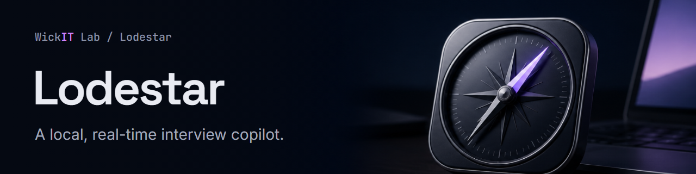

<p align="center">
  
</p>

**Local-first, real-time interview copilot for your desktop**

Lodestar listens to a call, transcribes both sides with speaker attribution, and answers the other party's questions on the spot, as short spoken lines you can read aloud. It runs on your machine as a discreet overlay: hidden from screen shares on a best-effort basis, out of the taskbar and Alt+Tab, and driveable from your phone as a second screen.

No account and no backend server. Your data (profiles, stories, saved sessions) lives on your machine. The cloud paths (Claude answers, Deepgram transcription) are opt-in, and there is a fully local mode (Ollama plus on-device Whisper) that keeps everything on the device.

Built with Tauri v2 (Rust) + React + Vite. The Rust core owns audio capture, screen capture, the model clients, and local storage; the React frontend is the UI.

**Platform:** Windows 10 or 11, x64 only. Audio loopback capture, the screen-share hiding, the taskbar and Alt+Tab hiding, UI Automation page reading, and key encryption all use Windows APIs, and the installers are built for x64 only (there is no ARM64 or macOS or Linux build).

> Lodestar began as a local-first job-market search tool. As of v0.3.0 it is focused entirely on the live interview copilot; the job-search, tracker, and study features were removed.

## Contents

- [Tech stack](#tech-stack)
- [Install](#install)
- [Accounts and keys](#accounts-and-keys)
- [Prerequisites](#prerequisites)
- [Getting started](#getting-started)
- [Fully local setup](#fully-local-setup)
- [First use](#first-use)
- [Features (built)](#features-built)
- [Using Lodestar](#using-lodestar)
- [Privacy and data](#privacy-and-data)
- [Legal and responsible use](#legal-and-responsible-use)
- [Troubleshooting](#troubleshooting)
- [Security](#security)
- [What's not yet built](#whats-not-yet-built)
- [License](#license)

## Tech stack

| Layer           | Technology                                          |
| --------------- | --------------------------------------------------- |
| Desktop         | Tauri v2 (Rust)                                     |
| Frontend        | React 19 + TypeScript + Vite                        |
| Storage         | SQLite (rusqlite, bundled)                          |
| HTTP            | reqwest (rustls, no OpenSSL)                        |
| Async runtime   | tokio                                               |
| Audio capture   | cpal (WASAPI loopback + microphone)                 |
| Local STT       | Candle (pure-Rust Whisper), tokenizers              |
| Cloud STT       | Deepgram (optional)                                 |
| Answer models   | Claude Messages API (streaming) and/or local Ollama |
| Screen capture  | xcap                                                |
| Screen reading  | UI Automation (uiautomation)                        |
| Markdown / math | react-markdown, remark-gfm, remark-math, KaTeX      |
| Icons           | lucide-react                                        |
| Package manager | pnpm                                                |

## Install

Download the latest Windows installer from the [Releases page](https://github.com/w1ck3ds0d4/Lodestar/releases/latest):

- `Lodestar_<version>_x64-setup.exe` - per-user install, no admin required (recommended)
- `Lodestar_<version>_x64_en-US.msi` - MSI package
- `SHA256SUMS.txt` - the checksums of the files above

Neither installer is code-signed, so Windows SmartScreen may show "Windows protected your PC" when you run the setup `.exe` or the `.msi`. Click **More info**, then **Run anyway**. Only do this for a file you downloaded from the Releases page of this repository and verified as below.

### Verify the download

The release workflow publishes a `SHA256SUMS.txt` file with each release. Download it next to the installer and compare the hash in PowerShell:

```powershell
Get-FileHash .\Lodestar_<version>_x64-setup.exe -Algorithm SHA256
Get-Content .\SHA256SUMS.txt
```

The hash printed by the first command must match the line for that file in `SHA256SUMS.txt` (case does not matter). If it differs, delete the file and do not run it.

Lodestar has no auto-updater: to update, download and install the newer release yourself. To build from source instead, follow [Getting started](#getting-started).

## Accounts and keys

| You want                                                 | You need                                                                 |
| -------------------------------------------------------- | ------------------------------------------------------------------------ |
| The fully local mode (Ollama answers, on-device Whisper) | Nothing: no account, no key. See [Fully local setup](#fully-local-setup) |
| Claude answers                                           | An Anthropic API key (pay-as-you-go, billed by Anthropic)                |
| Cloud transcription                                      | A Deepgram API key (billed by Deepgram)                                  |

Keys are pasted into **Settings** inside the app. They are stored encrypted with Windows DPAPI (see [Privacy and data](#privacy-and-data)). Lodestar itself has no account system and no subscription.

## Prerequisites

Only needed to build from source; the installers need none of this apart from the WebView2 Runtime (preinstalled on current Windows 10 and 11).

- [Rust stable toolchain](https://rustup.rs/)
- [Node.js](https://nodejs.org/) 20+
- [pnpm](https://pnpm.io/installation)
- Windows 10 / 11 x64 with the [WebView2 Runtime](https://developer.microsoft.com/microsoft-edge/webview2/), plus Visual Studio 2022 Build Tools with the "Desktop development with C++" workload

## Getting started

```bash
# 1. Clone and install
git clone https://github.com/w1ck3ds0d4/Lodestar.git
cd Lodestar
pnpm install

# 2. Run the app (boots and creates the local DB on first launch)
pnpm tauri dev

# 3. Build an installer (output under src-tauri/target/release/bundle/)
pnpm tauri build
```

The database is created in the app-data folder on first launch (see [Privacy and data](#privacy-and-data)). See [CONTRIBUTING.md](CONTRIBUTING.md) for the checks to run before a pull request.

> Note: a development build (`pnpm tauri dev`) runs an unoptimized Rust binary, so on-device Whisper transcription is much slower than the release installer. Cloud transcription (Deepgram) runs at the same speed either way.

## Fully local setup

This keeps audio, transcripts and answers on your computer.

1. Install [Ollama](https://ollama.com/) and start it (`ollama serve`, or the Ollama tray app).
2. Pull a model, for example `ollama pull llama3.1`. For the screen features, pull a vision model such as `llama3.2-vision`.
3. In Lodestar **Settings**, set the **Answer engine** to Ollama and pick the model. The Ollama address defaults to `http://localhost:11434`.
4. Set the **Transcription engine** to on-device Whisper. On first use Lodestar downloads the multilingual Whisper "base" model (`openai/whisper-base`, roughly 290 MB) from huggingface.co into its app-data folder. The download is pinned to a fixed revision and every file is checked against a built-in SHA-256 checksum; a file that does not match is refused. After that it works offline.

Local Whisper is slower than Deepgram on a CPU, and local answer quality depends on the Ollama model you choose.

## First use

1. Open Lodestar, then open **Settings** and choose your engines: Claude or Ollama for answers, Deepgram or on-device Whisper for transcription. Paste any API key you need.
2. Pick the capture source and devices (see [Using Lodestar](#using-lodestar)). The You / Them level meters confirm both sides are captured.
3. Click the person icon in the top bar and create a **profile** (role, resume, notes), then add **stories** (your real STAR stories) to it. The active profile grounds behavioral answers in your own experience.
4. Press **Listen** (or `Alt+Shift+L`) to start a session. The dialog fills with You / Them lines, and answers to the other party's questions stream in as short spoken lines.
5. Open **Capture mode** for the overlay: small always-on-top panels (Answers, Transcript, Controls, Shortcuts, Log) you can drag, resize and dim over your call. Press `Alt+Shift+H` to hide the whole window instantly.
6. Save the session when you finish; it appears in session history, where you can run a review.

### Phone second screen

In **Settings, Phone control**, start the phone server, then scan the QR code or open the shown address on your phone and enter the PIN.

- The phone must be on the same Wi-Fi network as the PC.
- Windows will ask for permission to open the port: Lodestar offers a one-click Windows Firewall fix (it asks for administrator approval) that marks the active network Private and allows the port on the local subnet only.
- The connection is plain HTTP and WebSocket on your LAN, with no TLS. A 6-digit PIN is the only protection. Each PIN allows 5 wrong attempts and is then replaced by a new one (the desktop shows it). After 3 replacements with no successful pairing the server stops itself and you have to start it again. The limit is shared by everyone on the network, so another device can force that stop by guessing wrong. Anyone on the same network who gets the PIN can read your live transcript and answers and drive the app, except that a phone can only switch screen-share protection on, never off.
- Do not use it on public, hotel, office, school or other untrusted Wi-Fi. Stop the server when you are done; it only runs when you start it.

## Features (built)

### The live copilot

- **Live transcription**: captures system audio (the other side of a call, via WASAPI loopback) and/or your microphone, with selectable input/output devices and a live input-level meter for diagnostics
- **Speaker-attributed dialog**: your mic and the call audio are transcribed separately and labeled (You vs Them); on Deepgram, the call side can be diarized into Speaker 1/2/...
- **Auto-answer**: questions from the other party are answered automatically (math, code, definitions, factual lookups), in any language, and **streamed token-by-token** so help appears the moment the model starts
- **Spoken, teleprompter-style answers**: written as a few complete first-person sentences you can read aloud verbatim (a one-line spoken roadmap for multi-part questions, trade-offs stated inline, a closing hand-off), with a dim non-spoken "Next:" follow-up hint, not study-note bullets
- **Streaming answers** rendered as Markdown with fenced code blocks and LaTeX (KaTeX); answers and their extracted code/equation snippets are grouped per question

### Answering

- **Answer engine**: Claude (cloud, default) or a local Ollama model
- **Models**: Claude Opus 5 (default), Sonnet 5, Haiku 4.5, and Fable 5.1, selectable per session; usage and cost estimates use each model's list price
- **Answer style**: Auto, Concise, STAR, or Code (solution + complexity), shapes every live and manual answer
- **Fast mode** (opt-in): runs the same model at up to 2.5x output speed on Opus 5 / Opus 4.8, at premium pricing, for when latency matters
- **Predicted follow-ups**: when an answer predicts the likely next question, it is pre-answered in the background and shown instantly (labeled "Predicted - verifying") until the real answer replaces it. On by default, with a toggle

### Context capture

- **Read full page**: one click reads the whole focused page's text via UI Automation, including content scrolled off-screen, and attaches it as de-duplicated, accumulating context. Works from an in-app button or the phone because it targets the last window you were on, not Lodestar
- **Read page (clipboard)**: a manual fallback for apps that expose no accessible text
- **Screen vision**: Watch / Answer screen / Snip screenshot the display and answer what is visible (on-screen multiple choice, diagrams)

### Grounding and accuracy

- **Interview context**: attach your role, resume, notes, and the company so answers are tailored; generate a company briefing plus questions to ask the interviewer
- **Story bank**: save real STAR stories once (or draft them from notes) so behavioral answers ground in your actual experience
- **Application kit**: tailors resume bullets, a cover letter, an ATS keyword match, and a thank-you note to a pasted job description
- **Overclaim guard** (opt-in): after an answer finishes, it is audited against your saved profile and any claim about your own experience the profile cannot support is flagged under the answer. General technical statements and hypotheticals are never flagged
- **Switchable profiles**: keep several interview personas (role, resume, notes, per-profile stories) and pick which one drives the answers, the screen reader, and the phone

### Review and improvement

- **Delivery coach**: live talk time, speaking pace (wpm), and filler-word count from your own side of the call, with "wrap up" and "slow down" nudges. Entirely local, no API cost
- **Session history**: save a live session's transcript and answers, then run an AI review-and-coach pass
- **Debrief**: ranks the topics that keep going badly across your saved sessions, worst first, so you know what to study. Built from the sessions themselves, cached per session so repeat runs are nearly free
- **Usage and cost** panel: live Deepgram balance, a local Claude token/cost estimate, and entered top-up credits with remaining

### Overlay, stealth, and remote

- **Overlay and stealth**: window opacity and always-on-top for a discreet overlay; a hide-from-screen-capture toggle (asks Windows to exclude the window from screen shares and recorders; best effort, see Legal and responsible use), with tooltips and dropdowns rendered in-window so they never pop out into a shared frame; the window is kept out of the taskbar, Alt+Tab, and Task Manager's app list via a hidden owner window; a custom borderless title bar; recall it from the system-tray icon, `Alt+Shift+H`, or an `MB5` double-click
- **Global shortcuts**: `Alt+Shift+` hotkeys (listen, answer screen, watch, read page, show/hide panels, opacity, panic-hide) that fire even while the call app is focused, with a Shortcuts cheat-sheet overlay
- **Phone remote**: a LAN web remote (no install) reached by QR / PIN on the same Wi-Fi that mirrors the transcript and answers and drives listening, screen-answering, opacity, and panel placement from your phone as a discreet second screen
- **Activity log**: a timestamped record of what each shortcut/action actually did (answered / screen unchanged / page chars attached / ...), as a Settings panel and a floating overlay panel
- **Adaptive layout**: a three-column workspace on wide windows that collapses to a Dialog / Answers tab switcher when narrow, plus a Settings tab that groups set-once configuration (Capture, Answers, Review) out of the live view

### Local-first and privacy

- SQLite (bundled) for profiles, stories, saved sessions, and settings, in the app-data folder
- API keys (Anthropic, Deepgram) are encrypted at rest with Windows DPAPI
- The cloud paths send data to their services only when selected; see [Privacy and data](#privacy-and-data)

## Using Lodestar

### 1. Set up audio and a model

In **Settings** (Capture and Answers):

- **Capture source**: `System` (the other side of the call, via WASAPI loopback), `Mic` (you), or `Both`. Pick the **output device** the call app plays to and your **input device**. The two-bar level meter (You / Them) confirms both sides are being captured; a flat "Them" bar usually means the call app is playing to a different output device than the one selected.
- **Transcription engine**: Deepgram (cloud, realtime, per-language, optional speaker diarization) or on-device Whisper (local, no key, slower on CPU).
- **Answer engine**: Claude (cloud, default) or a local Ollama model.
- Add your **Anthropic** and/or **Deepgram** API keys in Settings (see [Accounts and keys](#accounts-and-keys)).

### 2. Pick a profile

Open the **person icon** (top bar) to manage **profiles**, switchable interview personas, each with its own role, resume, notes, and STAR stories. The **active profile** grounds behavioral and fit answers in that persona (technical questions stay generic) and drives the screen reader and the phone.

### 3. Answer live

Press **Listen** (or `Alt+Shift+L`). The dialog transcribes with You/Them attribution and per-line timestamps. When the other party asks something, the **auto-answer** streams a short, spoken answer you can read aloud. You can also type a question into **Ask**.

### Keyboard shortcuts

All global (they fire even while your call app / browser is focused), all `Alt+Shift+`:

| Shortcut              | Action                                                           |
| --------------------- | ---------------------------------------------------------------- |
| `Alt+Shift+L`         | Listen on / off                                                  |
| `Alt+Shift+A`         | Answer whatever is on the screen now                             |
| `Alt+Shift+W`         | Watch screen on / off (re-reads and answers it)                  |
| `Alt+Shift+R`         | Read the focused page (full text, incl. off-screen) into context |
| `Alt+Shift+C`         | Show / hide the capture overlay panels                           |
| `Alt+Shift+Up / Down` | Opacity up / down                                                |
| `Alt+Shift+H`         | Panic-hide: instantly hide / show the window                     |

The same actions are listed in a **Shortcuts** overlay panel during capture mode, opened from the keyboard icon in the top bar.

### Mouse gestures

Global side-button gestures let you move and recall the overlay without touching the title bar:

| Gesture              | Action                                                       |
| -------------------- | ------------------------------------------------------------ |
| Hold `MB4`           | Peek behind: hide while held, reveal on release              |
| Drag with `MB5` held | Move the window                                              |
| Double-click `MB5`   | Hide / show the window (brings it to the front, keeps focus) |

### Reading the screen vs. the page

- **Watch screen** / **Answer screen**: screenshot the display and answer what is visible (good for on-screen multiple-choice, diagrams). "Watch" re-reads every few seconds and skips unchanged screens.
- **Read full page** (button / phone / `Alt+Shift+R`): reads the _entire_ focused page's text via UI Automation, including content scrolled off-screen, and attaches it as context with de-duplication and accumulation. Use this for long prompts and coding exercises, then Answer/Ask once.
- **Read page (clipboard)**: a manual fallback for apps that expose no accessible text; copy with `Ctrl+A`, `Ctrl+C`, then click.

The **Activity log** shows what each of these actually did, so it is clear which fired and how much it captured.

### Capture overlay & stealth

**Capture mode** opens small always-on-top panels (Answers, Transcript, Controls, Shortcuts, Log) you can drag, resize, and dim anywhere over a call; they are excluded from screen capture/sharing by default. The main window stays out of the taskbar, Alt+Tab, and Task Manager's app list (a hidden owner window keeps it under Background processes). Its tooltips and dropdowns render in-window so nothing pops out of a shared frame, and you bring it back from the system-tray icon, `Alt+Shift+H`, or an `MB5` double-click.

Note that content protection hides the _window_ from capture, but your mouse cursor is drawn by Windows outside any window, so it stays visible in a share. The keyboard shortcuts above drive the main actions without moving the cursor onto the overlay.

### Phone remote (discreet second screen)

See [Phone second screen](#phone-second-screen) for setup and the network caveats. The phone shows the live transcript and answers and gives a 9-tile remote: Audio Capture, Screen Capture, Opacity + and -, Read & Answer (with a monitor chooser for multiple displays), Watch Screen, Panels, Ask, and Read full page.

## Privacy and data

**Stored on your PC.** Profiles, stories, saved sessions and settings live in a SQLite database, `lodestar.db`, in `%APPDATA%\com.wickitlab.lodestar`, together with any downloaded Whisper model. The web view keeps its own data in `%LOCALAPPDATA%\com.wickitlab.lodestar`. The database is not encrypted: anyone who can read your Windows user profile can read your resume, notes, transcripts and answers. Raw audio is transcribed and discarded, not saved.

**Exported sessions.** The **Export** buttons in the session history write transcripts and answers as plain Markdown files to `Downloads\Lodestar` (or `Documents\Lodestar`, or the app-data folder, if there is no Downloads folder). They are not encrypted, Lodestar never deletes them, and they are not removed when you uninstall, so delete them yourself when you no longer need them.

**Removing everything.** Uninstall Lodestar, then delete `%APPDATA%\com.wickitlab.lodestar`, `%LOCALAPPDATA%\com.wickitlab.lodestar` and any exported files in `Downloads\Lodestar`.

**Upgrading from an older install.** Versions before 0.4.0 used the identifier `com.w1ck3ds0d4.jobradar` and a database named `jobradar.db`. On the first launch of the new version your data is copied once, and the database is renamed to `lodestar.db`. The old folders (`%APPDATA%\com.w1ck3ds0d4.jobradar` and `%LOCALAPPDATA%\com.w1ck3ds0d4.jobradar`) are never changed or deleted by Lodestar. Once you have checked that your profiles and sessions are there, you can delete them yourself. Close the old version before you install, so its database is not being written while it is copied.

**API keys.** Anthropic and Deepgram keys are encrypted with Windows DPAPI (current-user scope) before they go in the database, so they cannot be read by another Windows user or on another machine. If encryption fails the app refuses to save the key rather than storing it in plain text. Keys are never logged and are only sent to the service they belong to.

**What leaves your machine, and when.** Nothing is contacted until you use the feature:

| Endpoint                                               | When                                                                                       | What is sent                                                                     |
| ------------------------------------------------------ | ------------------------------------------------------------------------------------------ | -------------------------------------------------------------------------------- |
| `api.anthropic.com`                                    | Claude is the answer engine and a question, review, briefing or screen answer is requested | The question, context from your profile, and screenshots for the vision features |
| `api.deepgram.com` (WebSocket)                         | Deepgram is the transcription engine and you are listening                                 | Captured audio                                                                   |
| `api.deepgram.com` (REST)                              | You open the usage panel with a Deepgram key set                                           | Your key, to read the account balance                                            |
| `huggingface.co`                                       | On-device Whisper is selected and the model is not yet downloaded (first use only)         | A download request; nothing of yours                                             |
| Your Ollama address (default `http://localhost:11434`) | Ollama is the answer engine                                                                | The same content as a Claude request, to the address you set                     |
| `console.anthropic.com`, `console.deepgram.com`        | You click a link to those consoles; it opens in your browser                               | Nothing from the app                                                             |

Anthropic's and Deepgram's own terms and retention policies apply to what you send them. If you point Ollama at another machine, that machine receives your content.

**No telemetry, no auto-update.** Lodestar sends no analytics or crash reports and never checks for updates. Update by hand from the Releases page.

## Legal and responsible use

Read this before using Lodestar on a real call.

1. **Recording and transcribing other people.** Transcribing a call is recording it. Many places require every party to consent (all-party or two-party consent), and the law can treat a transcript like a recording. You are responsible for knowing the law where you and the other people are, and for getting consent where it is needed.
2. **Interviews, exams and employers.** Many interviews, assessments, exams and employers ban outside help, AI tools, recording or hidden tools. Using Lodestar against those rules can cost you an offer, a job or a qualification. Check and follow them.
3. **Hiding from screen shares is best effort.** Lodestar asks Windows to exclude its window from capture. This depends on the Windows version, the graphics driver and the sharing or recording software, and it can fail. Some capture tools and remote-control software can still see the window, and your mouse cursor is not hidden. Do not rely on it for anything that matters.
4. **Where your data goes.** Your profiles, stories and transcripts stay on this PC and are stored unencrypted (see [Privacy and data](#privacy-and-data)). When you enable Claude or Deepgram, the audio, text and screenshots you send go to those services under their terms.
5. **Antivirus may flag it.** An app that hides its window from screen capture and from the taskbar can look like malware to security software, and some tools or managed devices will flag or block it. On a work or school computer, check that the policy allows it.

You are solely responsible for how you use the software, under the terms of the [license](LICENSE), which provides no warranty.

## Troubleshooting

- **SmartScreen says "Windows protected your PC".** The installers are unsigned. After verifying the download against `SHA256SUMS.txt`, click **More info**, then **Run anyway**.
- **The phone cannot connect.** Check that the phone and PC are on the same Wi-Fi (not a guest network with client isolation), that the server is started, and that Windows Firewall allows the port. Use the firewall fix in **Settings, Phone control**, or allow `mcp_lodestar.exe` on Private networks when Windows prompts. If you entered the PIN wrong 5 times, the desktop shows a new PIN; use that one. If the server stopped after repeated wrong PINs, start it again in **Settings, Phone control**.
- **The "Them" meter stays flat.** The call app is playing to a different output device than the one selected in Settings. Pick the output device the call uses, and check that the capture source is not set to Mic only. Also check that the call is not muted.
- **Answers do not appear.** Check that the answer engine matches what you set up: a valid Anthropic key for Claude, or Ollama running with the model pulled.
- **Local transcription is slow.** Use the installer build rather than `pnpm tauri dev`, or use Deepgram.
- **Antivirus flags the app.** See the antivirus point (5) in [Legal and responsible use](#legal-and-responsible-use).

## Security

See [SECURITY.md](SECURITY.md) for what the app touches, its threat model, and how to report a vulnerability privately. Please do not open a public issue for a vulnerability.

## What's not yet built

- Real-time streaming transcription (the current pipeline transcribes in ~4s chunks; cross-chunk speaker numbering is therefore not stable)
- Live web lookup for the company briefing (currently uses the model's own knowledge plus what you enter)
- An auto-updater and code-signed releases (the installers are currently unsigned)
- macOS, Linux and Windows ARM64 builds

## License

This project is dual-licensed:

- [AGPL-3.0-or-later](LICENSE) for everyone. You may use it personally, study it, modify it and redistribute it under the AGPL. If you distribute a modified version or run one as a network service, you must offer its source under the AGPL.
- [Commercial license](COMMERCIAL.md) for proprietary redistribution or a hosted service that does not want to comply with the AGPL. Personal use needs no license.
